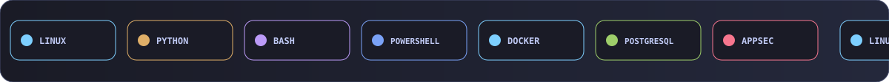
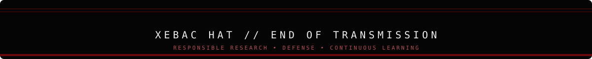

<!-- XEBAC HAT | Cyberpunk profile README -->
<div align="center">
  <a href="https://github.com/obunto-byte">
    
  </a>

  <p>
    <strong>DEFENSIVE SECURITY</strong> &nbsp;·&nbsp;
    <strong>PYTHON AUTOMATION</strong> &nbsp;·&nbsp;
    <strong>SYSTEMS RESEARCH</strong>
  </p>

  <p>
    <a href="https://github.com/obunto-byte?tab=repositories"></a>
    <a href="https://github.com/obunto-byte/obunto-byte"></a>
  </p>

  <p>
    
    
    
  </p>

  <sub>◈ SYSTEM STATUS: ONLINE &nbsp;·&nbsp; SECURITY MODE: AUTHORIZED RESEARCH &nbsp;·&nbsp; THEME: NEON CYBERPUNK ◈</sub>
</div>

---

## `01 // IDENTITY CORE`

<table>
  <tr>
    <td width="58%" valign="top">
      <strong>$ whoami</strong>

      I'm **XEBAC HAT** — an independent builder focused on defensive security, web and API security concepts, Python automation, and practical tools that make systems easier to understand and protect.

      I enjoy exploring how applications work, validating security controls in authorized environments, and turning technical findings into clear, useful improvements.

      **CURRENT TRANSMISSION**
      - Building and refining the XEBAC HAT security-tool ecosystem
      - Exploring web application and API security
      - Developing Python utilities and repeatable workflows
      - Documenting findings, limitations, and defensive improvements
    </td>
    <td width="42%" valign="top" align="center">
      
    </td>
  </tr>
</table>

> **Operating philosophy:** Understand the system. Validate the risk. Strengthen the defense.

## `02 // FEATURED BUILD`

<table>
  <tr>
    <td width="68%" valign="top">
      <h3>◈ XEBAC HAT — Web Security Auditor</h3>
      A Python-based utility documented for educational use and authorized web security testing.

      **Documented capabilities**
      - Checks common administrative paths
      - Looks for publicly exposed backup-file paths
      - Uses concurrent checks for faster discovery
      - Produces JSON and TXT reports

      <a href="https://github.com/obunto-byte/admin-panle-finder-"></a>
    </td>
    <td width="32%" valign="middle" align="center">
      
      <sub>PROJECT SIGNAL // ACTIVE</sub>
    </td>
  </tr>
</table>

<p align="center">
  <a href="https://github.com/obunto-byte?tab=repositories">⌁ Browse all public repositories →</a>
</p>

## `03 // RESEARCH DIRECTIVES`

<table>
  <tr>
    <td width="50%" valign="top">
      <h3>⌁ Web & API Security</h3>
      Application-security fundamentals, access-control review, input validation, and responsible testing.
    </td>
    <td width="50%" valign="top">
      <h3>⌁ Defensive Engineering</h3>
      Safer defaults, security controls, risk reduction, and practical remediation ideas.
    </td>
  </tr>
  <tr>
    <td width="50%" valign="top">
      <h3>⌁ Python Automation</h3>
      Small utilities, repeatable checks, structured output, and workflow improvements.
    </td>
    <td width="50%" valign="top">
      <h3>⌁ Research & Documentation</h3>
      Clear technical notes, reproducible observations, and responsible knowledge sharing.
    </td>
  </tr>
</table>

## `04 // TECH ARSENAL`

<p align="center">
  
</p>

<p align="center">
  <sub>PYTHON · WEB SECURITY · DEFENSIVE TOOLING · AUTOMATION · TECHNICAL RESEARCH</sub>
</p>

## `05 // GITHUB TELEMETRY`

<p align="center">
  
</p>

<p align="center">
  
</p>

<p align="center">
  <picture>
    <source media="(prefers-color-scheme: dark)" srcset="./dist/github-snake-dark.svg" />
    <source media="(prefers-color-scheme: light)" srcset="./dist/github-snake.svg" />
    
  </picture>
</p>

<p align="center">
  <sub>LIVE PROFILE VISUALS · CONTRIBUTION SIGNAL · NEON CYBERNETIC MODE</sub>
</p>

## `06 // OPERATING PROTOCOL`

```text
[01] Work only within an authorized scope.
[02] Verify observations before describing risk.
[03] Protect credentials, evidence, and user data.
[04] Prefer secure defaults and defense in depth.
[05] Document limitations and practical remediation.
[06] Share knowledge responsibly.
```

## `07 // ESTABLISH CONNECTION`

<div align="center">
  <a href="https://github.com/obunto-byte"></a>
  <a href="https://github.com/obunto-byte?tab=repositories"></a>

  <p><strong>Build securely. Think critically. Share responsibly.</strong></p>
  <sub>END OF TRANSMISSION // XEBAC HAT</sub>
</div>


