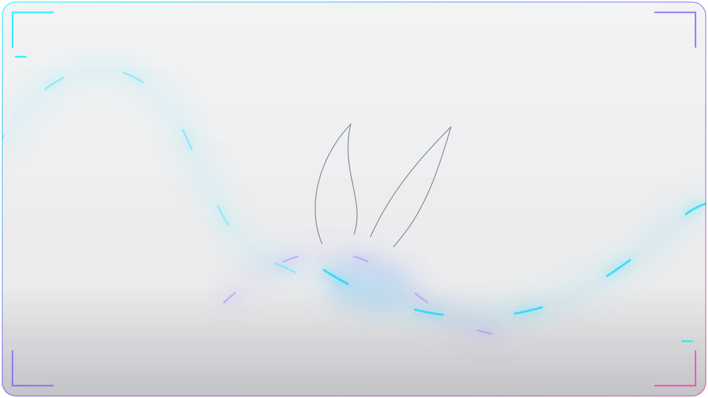
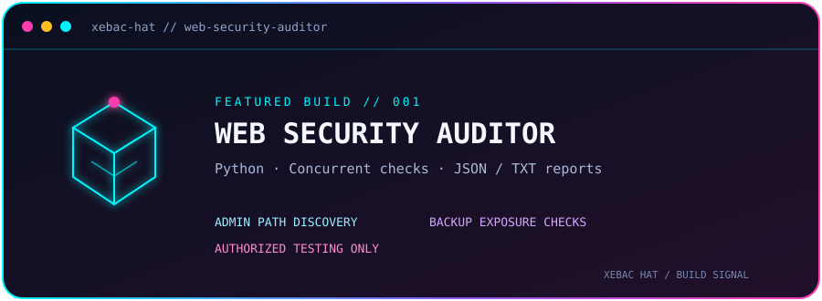
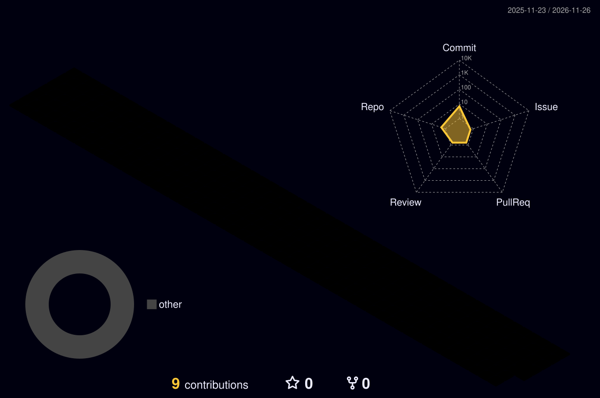

<!-- XEBAC HAT | Cyberpunk GitHub profile -->
<div align="center">
  <a href="https://github.com/obunto-byte">
    
  </a>

  

  <p>
    <a href="https://obunto-byte.github.io/"></a>
    <a href="https://github.com/obunto-byte?tab=repositories"></a>
  </p>
  <p>
    <a href="https://github.com/obunto-byte?tab=followers"></a>
    <a href="https://github.com/obunto-byte?tab=repositories"></a>
    
  </p>
  <sub>◈ XEBAC HAT · DEFENSIVE SECURITY · RESPONSIBLE ENGINEERING ◈</sub>

  <p><a href="#01--engineering-profile">About</a> · <a href="#02--featured-projects">Projects</a> · <a href="#03--technical-toolkit">Toolkit</a> · <a href="#04--github-telemetry">Activity</a> · <a href="#05--engineering-principles">Principles</a></p>
</div>

---

## 01 / Engineering profile

I'm **XEBAC HAT**, a developer focused on defensive security, Python automation, application monitoring, and practical web/API engineering.

I build and document tools that help developers understand system behaviour, review security controls, and improve the reliability of their applications.

| Focus area | Current interests |
| :--- | :--- |
| **Defensive security** | Security monitoring, secure configuration, access-control design |
| **Backend engineering** | Python, FastAPI, REST APIs, PostgreSQL, SQLite |
| **Application monitoring** | Event ingestion, session correlation, explainable detection |
| **Automation** | Repeatable local checks, structured reports, developer workflows |
| **Windows development** | Local-first setup, debugging, practical tooling |

> My approach: work within authorized scope, prefer safe defaults, validate findings, and document limitations clearly.



## 02 / Featured projects

<div align="center">
  <a href="https://github.com/obunto-byte/XEBAC_HAT_AI_IDS_V2">
    
  </a>
  <a href="https://github.com/obunto-byte/xebachat">
    
  </a>
</div>

### XEBAC HAT AI-IDS v2
**Windows-first defensive monitoring prototype**

A local-first application-security monitoring prototype built with FastAPI and SQLite. It ingests authorized telemetry, correlates events into sessions, applies explainable behavioural rules, and presents incidents in a dashboard.

- Event ingestion, session correlation, and incident history.
- Explainable behavioural detection and synthetic demo events.
- Windows-oriented setup with a local dashboard.
- Prototype only; not a certified enterprise IDS. Do not expose it directly to the public internet.

[Repository and setup guide](https://github.com/obunto-byte/XEBAC_HAT_AI_IDS_V2)

### xebachat v1.2
**Endpoint and parameter reference discovery**

A Python crawler that extracts URL references from web resources for authorized assessments.

- Parses HTML, JavaScript, CSS, XML, JSON, and text.
- Bounded crawl depth, deduplication, pacing, and structured output.
- Includes documented limitations and responsible-use guidance.

[Repository and documentation](https://github.com/obunto-byte/xebachat)

### Explore more
[All repositories](https://github.com/obunto-byte?tab=repositories) · [Portfolio](https://obunto-byte.github.io/)

## 03 / Technical toolkit

<div align="center">

**Languages & development**


**Platforms & engineering**


</div>

| Domain | Tools and concepts |
| :--- | :--- |
| Backend | Python, FastAPI, REST APIs |
| Data | PostgreSQL, SQLite |
| Operating systems | Windows, Linux |
| Workflow | Git, GitHub, VS Code |
| Security | Defensive monitoring, secure configuration, access-control reviews |

## 04 / GitHub telemetry

<div align="center">
  
  
  <sub>LIVE CONTRIBUTION VISUALS · AUTOMATICALLY REFRESHED BY GITHUB ACTIONS</sub>
</div>

<div align="center">
  
</div>

<div align="center">
  
  
  
  <sub>Public GitHub activity; third-party cards may occasionally be unavailable.</sub>
</div>

## 05 / Engineering principles

```text
01  Work only within systems I own or am authorized to assess.
02  Prefer safe defaults and defense in depth.
03  Protect credentials, tokens, and personal information.
04  Validate findings and communicate uncertainty.
05  Document setup, limitations, and remediation.
06  Share knowledge responsibly.
```

## 06 / Connect & explore

<div align="center">
  <a href="https://github.com/obunto-byte?tab=repositories"></a>
  <a href="https://obunto-byte.github.io/"></a>
  <p><strong>Build securely. Think critically. Share responsibly.</strong></p>
  <sub>END OF TRANSMISSION // XEBAC HAT</sub>
</div>


