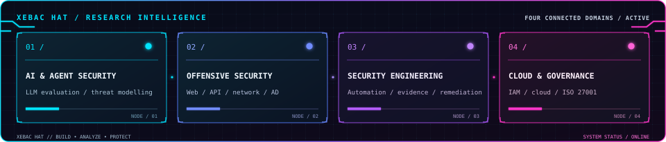
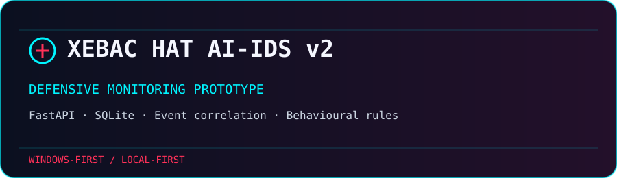
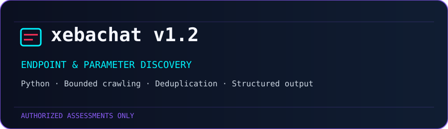
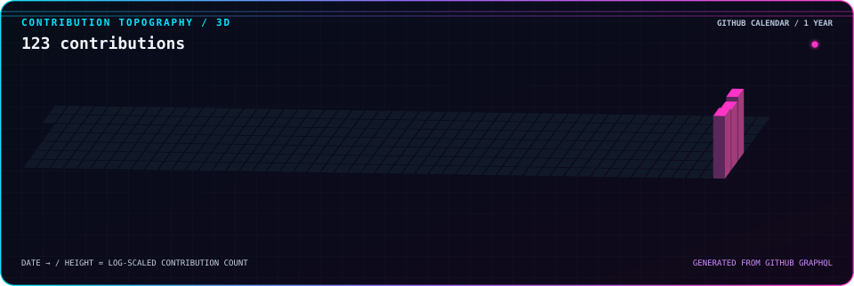
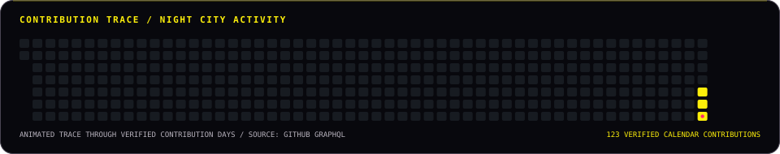

<!-- XEBAC HAT | LUMINAL-inspired profile README -->
<div align="center">

  <a href="https://obunto-byte.github.io/#projects">
    
  </a>

  

  <p>
    <a href="https://obunto-byte.github.io/"></a>
    <a href="https://github.com/obunto-byte"></a>
    <a href="https://github.com/obunto-byte?tab=repositories"></a>
  </p>

  <p>
    
    
    
  </p>

  [01 / Profile](#01--engineering-profile) · [02 / Projects](#02--featured-projects) · [03 / Focus](#03--research--engineering-focus) · [04 / Toolkit](#04--technical-toolkit) · [05 / Activity](#05--github-telemetry) · [06 / Connect](#06--connect)

</div>

---

## 01 / Engineering profile

I'm building **XEBAC HAT** — a practical software and defensive-security project focused on security visibility, safer application development, and understandable engineering workflows.

I work primarily with Python and backend tooling, and I enjoy turning security concepts into documented, testable projects. My approach is defensive-first: understand the system, define an authorized scope, protect data, validate behavior, and explain the limits of every result.

| Focus area | Engineering & practice |
| :--- | :--- |
| **Defensive security** | Security monitoring concepts, event visibility, incident context, and safe validation |
| **Backend engineering** | Python, FastAPI, REST APIs, application structure |
| **Data & storage** | SQLite, PostgreSQL concepts, structured event records |
| **Developer workflow** | Windows, Linux, VS Code, Git, GitHub |
| **Responsible research** | Authorized environments, reproducible notes, privacy-aware telemetry |

<div align="center">

  

</div>

> **Build securely. Verify carefully. Share responsibly.**

## 02 / Featured projects

<div align="center">

  <a href="https://github.com/obunto-byte/XEBAC_HAT_AI_IDS_V2">
    
  </a>
  <a href="https://github.com/obunto-byte/xebachat">
    
  </a>

</div>

| Project | What it is |
| :--- | :--- |
| [**XEBAC HAT AI-IDS V2**](https://github.com/obunto-byte/XEBAC_HAT_AI_IDS_V2) | Windows-first, local-first defensive monitoring prototype using FastAPI and SQLite. Includes event ingestion, session context, explainable behavioral rules, and a local dashboard. |
| [**xebachat**](https://github.com/obunto-byte/xebachat) | A bounded URL-reference crawler for organizing web resource references during authorized assessment work. Includes crawl limits, deduplication, pacing, and structured output. |
| [**XEBAC HAT Portfolio**](https://obunto-byte.github.io/) | Personal project site featuring the XEBAC HAT identity, engineering notes, project gallery, and animated security-core visual. |
| [**All public repositories**](https://github.com/obunto-byte?tab=repositories) | Browse the wider repository list and individual project documentation. |

<details>
<summary><b>Project status & responsible-use notes</b></summary>

- **AI-IDS V2** is a prototype/lab project, not a certified enterprise intrusion-detection system. Keep its development services local unless deployment security has been reviewed.
- **xebachat** is intended only for websites and environments you own or have explicit permission to assess. Respect scope, rate limits, privacy, and service stability.
- Other public repositories may be experimental or incomplete. Read their own documentation and review their code before relying on them.

</details>

## 03 / Research & engineering focus

```text
CURRENT BUILD / LEARNING TRACK
  ├── Defensive monitoring and event correlation
  ├── Python application and API engineering
  ├── Authentication design and secure defaults
  ├── Local-first developer security tools
  └── Documentation, testing, and responsible disclosure
```

I prefer projects that explain what they check, what their results mean, and what they cannot prove. I do not claim certifications or professional credentials that are not publicly verified.

## 04 / Technical toolkit

<div align="center">

**Languages & development**


**Backend, data & platforms**


**Engineering themes**


</div>

## 05 / GitHub telemetry

<div align="center">

  

  

  <sub>Both panels are generated from the GitHub contribution calendar by this repository's Actions workflow. Bar height and cell brightness reflect recorded daily activity; no sample calendar values are substituted.</sub>

</div>

## 06 / Connect

<div align="center">

  <a href="https://github.com/obunto-byte">
    
  </a>
  <a href="https://obunto-byte.github.io/">
    
  </a>

  **XEBAC HAT // BUILD · REVIEW · IMPROVE**

  <sub>Defensive security engineering · Practical software · Responsible research</sub>

  

</div>
