<!-- XEBAC HAT | GitHub profile -->

  

  

  

    
    
    
  

  

    
    
    
  

  [About](#01--engineering-profile) · [Projects](#02--featured-projects) · [Toolkit](#03--technical-toolkit) · [Activity](#04--github-telemetry) · [Principles](#05--security-principles) · [Contact](#06--connect)

## 01 / Engineering profile

I'm building **XEBAC HAT**, a defensive security and software engineering project focused on practical monitoring, safer application development, and explainable security workflows.

My interests include Python development, backend APIs, local-first security tooling, event monitoring, and documenting how systems behave. I aim to keep projects understandable, scoped, and useful for legitimate defensive work.

| Focus area | Engineering & practice |
| :--- | :--- |
| **Defensive security** | Event monitoring, security visibility, detection concepts, and safe validation |
| **Backend development** | Python, FastAPI, REST APIs, authentication concepts |
| **Data & storage** | PostgreSQL, SQLite, structured event data |
| **Developer tooling** | Windows workflows, VS Code, Git, automation |
| **Responsible research** | Authorized environments, reproducible notes, clear limitations |

> My approach: define the scope, protect data, validate behavior, explain findings, and prioritize practical mitigations.

## 02 / Featured projects

  
  
  
  

| Project | Purpose |
| :--- | :--- |
| [XEBAC HAT AI-IDS V2](https://github.com/obunto-byte/XEBAC_HAT_AI_IDS_V2) | Windows-first, local-first defensive monitoring prototype with event ingestion, session context, and explainable detection concepts. |
| [xebachat](https://github.com/obunto-byte/xebachat) | Bounded URL-reference crawler for organizing publicly reachable web resource references in authorized workflows. |
| [XEBAC Hybrid V2](https://github.com/obunto-byte/xebac-hybrid-v2) | Security tooling and research repository; review its scope, documentation, and limitations before use. |
| [Portfolio](https://github.com/obunto-byte/obunto-byte.github.io) | Personal project and development portfolio. |

<b>More repositories</b>

- [admin-panle-finder-](https://github.com/obunto-byte/admin-panle-finder-) — experimental web-path discovery project; use only in systems you own or are explicitly authorized to assess.
- [All repositories](https://github.com/obunto-byte?tab=repositories)

*Project status note: XEBAC HAT AI-IDS V2 is a prototype, not a certified enterprise IDS. Do not expose local development services directly to the public internet. Review each repository's README and security notes for current setup and limitations.*

## 03 / Technical toolkit

**Languages & development**

**Backend, data & platforms**

**Security & engineering concepts**

## 04 / GitHub telemetry

  
  
  
  

  <h3>Contribution activity</h3>
  
  Contribution animation depends on the repository's GitHub Actions workflow and generated output branch.

Statistics are supplied by external services and may occasionally be unavailable or delayed.

## 05 / Security principles

- **Authorized scope:** work only on systems owned by you or where you have explicit permission.
- **Secure defaults:** keep development services local unless deployment security has been reviewed.
- **Protect secrets:** never commit passwords, API keys, tokens, or private data.
- **Explainable results:** document what a tool checks and what its output does not prove.
- **Responsible disclosure:** communicate issues privately and follow the relevant program rules.
- **Continuous improvement:** test, review, document, and refine.

## 06 / Connect

  
  

  **Build securely. Verify carefully. Share responsibly.**

  Defensive security engineering · Practical software · Responsible research
  

