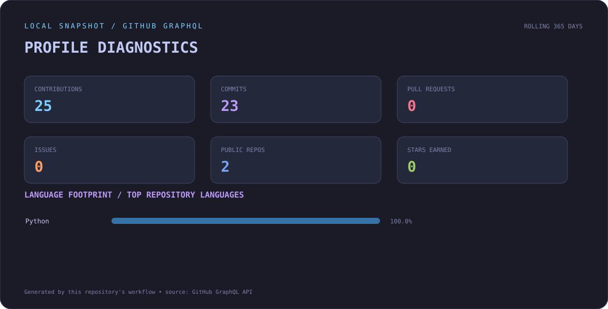

<!-- XEBAC HAT | Cyberpunk security engineering profile -->
<div align="center">
  <a href="https://github.com/obunto-byte">
    
  </a>

  

  <p>
    <a href="https://obunto-byte.github.io/"></a>
    <a href="https://github.com/obunto-byte?tab=repositories"></a>
    <a href="https://github.com/obunto-byte/obunto-byte"></a>
  </p>

  <p>
    
    
    
  </p>

  <sub>◈ IDENTITY CORE: ONLINE &nbsp;·&nbsp; SECURITY MODE: AUTHORIZED RESEARCH &nbsp;·&nbsp; NEURAL LINK: STABLE ◈</sub>
</div>

---

## 01 / Research profile

I'm **XEBAC HAT** — a security-focused builder exploring defensive server security, web and API security, Python automation, and practical developer tools.

My approach is to understand how systems behave, test security controls within an authorized scope, and turn observations into clear improvements. I use this profile to share project progress, experiments, and lessons from building security-focused software.

<table>
  <tr>
    <td width="50%" valign="top">

**RESEARCH FOCUS**

- Web application and API security
- Defensive server security
- Security monitoring concepts
- Access-control and authentication design

    </td>
    <td width="50%" valign="top">

**ENGINEERING FOCUS**

- Python development and automation
- FastAPI and backend workflows
- PostgreSQL-backed applications
- Windows developer tooling

    </td>
  </tr>
</table>

<p align="center">
  
</p>

> **Operating principle:** Understand the system. Validate the risk. Strengthen the defense.

## 02 / Featured engineering projects

<div align="center">
  <a href="https://github.com/obunto-byte/admin-panle-finder-">
    
  </a>
</div>

### XEBAC HAT — Web Security Auditor

A Python-based web security utility documented for educational use and authorized testing.

| Capability | Project description |
| :--- | :--- |
| Admin-path discovery | Checks common administrative URL paths |
| Backup exposure checks | Looks for publicly accessible backup-file paths |
| Concurrent execution | Uses Python thread pooling for checks |
| Reporting | Produces JSON and TXT reports |

<p align="center">
  <a href="https://github.com/obunto-byte/admin-panle-finder-"></a>
  <a href="https://github.com/obunto-byte?tab=repositories"></a>
</p>

## 03 / Current build tracks

<table>
  <tr>
    <td width="50%" valign="top">

### ◈ XEBAC HAT Security Platform

**In development**

Building toward a defensive server-security platform with an emphasis on monitoring, access controls, and practical security workflows for developers.

    </td>
    <td width="50%" valign="top">

### ◈ Web & API Security

Exploring application behavior, authentication boundaries, input handling, and responsible vulnerability validation in authorized environments.

    </td>
  </tr>
  <tr>
    <td width="50%" valign="top">

### ◈ Security Automation

Creating Python utilities, repeatable checks, structured reports, and tools that make defensive work easier to operate.

    </td>
    <td width="50%" valign="top">

### ◈ Research & Documentation

Recording reproducible observations, technical notes, limitations, and practical remediation guidance.

    </td>
  </tr>
</table>

## 04 / Technical toolkit

<div align="center">

**Languages, frameworks & platforms**


**Security & engineering interests**


</div>

## 05 / GitHub telemetry

<div align="center">
  
  <br/>
  
  <br/>
  <picture>
    <source media="(prefers-color-scheme: dark)" srcset="./dist/github-snake-dark.svg" />
    <source media="(prefers-color-scheme: light)" srcset="./dist/github-snake.svg" />
    
  </picture>
  <sub>PROFILE VISUALS · CONTRIBUTION SIGNAL · NEON CYBERNETIC MODE</sub>
</div>

<details>
  <summary><b>Optional coding-time panel (WakaTime)</b></summary>

  The profile repository includes an optional WakaTime panel. To enable it, add a repository Actions secret named `WAKATIME_API_KEY` under **Settings → Secrets and variables → Actions**. The generator publishes a static SVG and does not place the API key in the generated image. Without the secret, the panel displays setup guidance.
</details>

## 06 / Operating principles

```text
[01] Test only systems I own or am authorized to assess.
[02] Verify findings; do not exaggerate impact.
[03] Protect credentials, evidence, and user data.
[04] Prefer secure defaults and defense in depth.
[05] Document limitations and practical remediation.
[06] Share knowledge responsibly.
```

## 07 / Connect

<div align="center">
  <a href="https://github.com/obunto-byte"></a>
  <a href="https://github.com/obunto-byte?tab=repositories"></a>
  <p><strong>Build securely. Think critically. Share responsibly.</strong></p>
  <sub>END OF TRANSMISSION // XEBAC HAT</sub>
</div>


