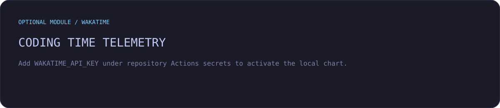
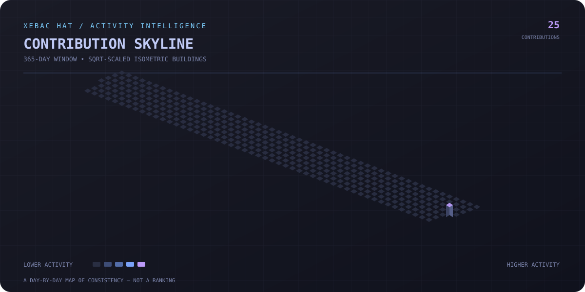

<!-- XEBAC HAT | Profile README | local Tokyo Night security theme -->
<p align="center"></p>
<p align="center">XEBAC HAT · RED TEAM METHODOLOGY · SECURITY RESEARCH · DEFENSIVE ENGINEERING</p>
<p align="center"><a href="https://github.com/obunto-byte">GitHub Profile</a> · <a href="https://github.com/obunto-byte?tab=repositories">Public Repositories</a> · <a href="https://github.com/obunto-byte/obunto-byte/actions">Profile Automation</a></p>

<table align="center" width="88%" border="0">
  <tr>
    <td valign="top" align="left" width="64%">

### currently

Exploring web and API security, red-team methodology, vulnerability analysis, and defensive automation. My focus is on authorized testing, careful validation, and practical security improvements.

### writing

I use this space to document project progress, security-tool development, analysis workflows, and lessons that can help make systems safer.

    </td>
    <td valign="top" align="right" width="36%">
      <em>“Understand the system. Validate the risk. Strengthen the defense.”</em><br>
      <sub>— XEBAC HAT</sub><br><br>
      <a href="https://github.com/obunto-byte">GitHub Profile</a><br>
      <a href="https://github.com/obunto-byte?tab=repositories">Public Repositories</a>
    </td>
  </tr>
</table>

---

## `┌─[ 01 ] whoami`

<p align="center"></p>

I'm **Xebac Hat** — an independent security-focused builder interested in understanding how software and systems fail, validating security controls, and creating practical tools that improve security.

| Area | What I'm exploring |
|---|---|
| **Web & API security** | Attack-surface review, application security and secure testing |
| **Red-team methodology** | Threat modeling, controlled security assessments and clear reporting |
| **APK & file analysis** | Static inspection, suspicious-file triage and safe handling |
| **Malware defense** | Detection concepts, quarantine workflows and defensive analysis |
| **Security automation** | Repeatable Python and shell utilities for analysis and reporting |

> All security testing should be limited to systems you own or have explicit permission to assess.

## `┌─[ 02 ] arsenal & technology`

<p align="center"></p>

<p align="center">WEB SECURITY · AUTHORIZED RED TEAMING · MALWARE DEFENSE · PYTHON AUTOMATION</p>

## `┌─[ 03 ] current build tracks`

<table>
  <tr>
    <td width="50%" valign="top">

### ◈ Web Security Lab

Learning and building around web application review, API security, reconnaissance workflows and responsible vulnerability validation.

</td>
    <td width="50%" valign="top">

### ◈ XEBAC HAT Defense

Exploring file and APK inspection, malware triage, safe quarantine concepts and defensive security utilities.

</td>
  </tr>
  <tr>
    <td width="50%" valign="top">

### ◈ Security Automation

Python and shell-based utilities, structured analysis, repeatable checks and useful reporting.

</td>
    <td width="50%" valign="top">

### ◈ Research & Documentation

Clear notes, reproducible findings, remediation guidance and responsible disclosure practices.

</td>
  </tr>
</table>

<p align="center"><a href="https://github.com/obunto-byte?tab=repositories">Explore public repositories →</a></p>

## `┌─[ 04 ] GitHub diagnostics`

<p align="center"></p>

<p align="center"></p>

> **WakaTime setup (optional):** Add a repository Actions secret named `WAKATIME_API_KEY` under **Settings → Secrets and variables → Actions**. The workflow fetches your last-7-days language breakdown and commits a static SVG into this repository. Without the secret, the card shows setup instructions. Your API key is never written into the generated file.

## `┌─[ 05 ] contribution skyline`

<p align="center"></p>

## `┌─[ 06 ] 3D contribution matrix`

<p align="center"></p>

## `┌─[ 07 ] contribution snake`

<p align="center">
  <picture>
    <source media="(prefers-color-scheme: dark)" srcset="./dist/github-snake-dark.svg" />
    <source media="(prefers-color-scheme: light)" srcset="./dist/github-snake.svg" />
    
  </picture>
</p>

## `┌─[ 08 ] operating principles`

```text
01  Test only within an authorized scope.
02  Verify findings; don't exaggerate impact.
03  Protect evidence, credentials and user data.
04  Document reproduction steps and remediation.
05  Prefer secure defaults and defense in depth.
06  Share knowledge responsibly.
```

## `└─[ 09 ] connect`

<p align="center"><a href="https://github.com/obunto-byte">GITHUB: obunto-byte</a> · <a href="https://github.com/obunto-byte?tab=repositories">REPOSITORIES</a></p>

<p align="center"><sub>Curiosity finds the weakness. Discipline validates it. Research helps build the defense.</sub></p>


