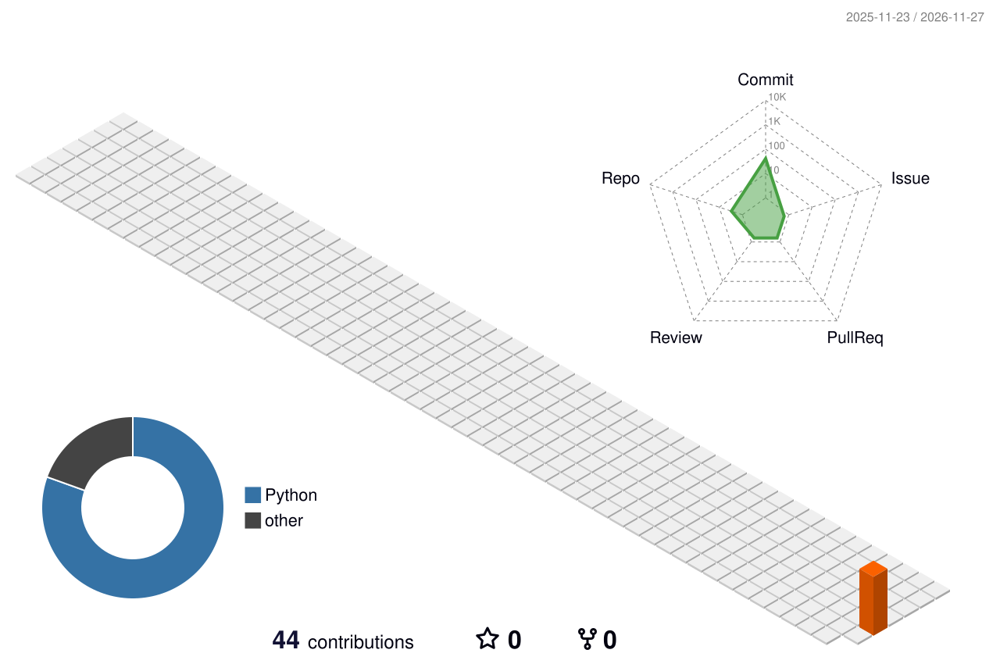

<!-- XEBAC HAT | Profile README | original red-team security theme -->

<a href="https://github.com/obunto-byte">
  
</a>

<p align="center">
  
</p>

<p align="center">
  <a href="https://github.com/obunto-byte"></a>
  <a href="https://github.com/obunto-byte?tab=followers"></a>
  <a href="https://github.com/obunto-byte?tab=repositories"></a>
  <a href="https://github.com/obunto-byte/obunto-byte/actions/workflows/profile-visuals.yml"></a>
</p>

---

## `┌─[ 01 ] whoami`

<p align="center">
  
</p>

I'm **Xebac Hat** — an independent security-focused builder interested in understanding how software and systems fail, validating security controls, and creating practical tools that improve security.

| Area | What I'm exploring |
|---|---|
| **Web & API security** | Attack-surface review, application security and secure testing |
| **Red-team methodology** | Threat modeling, controlled security assessments and clear reporting |
| **APK & file analysis** | Static inspection, suspicious-file triage and safe handling |
| **Malware defense** | Detection concepts, quarantine workflows and defensive analysis |
| **Security automation** | Repeatable Python and shell utilities for analysis and reporting |

> All security testing should be limited to systems you own or have explicit permission to assess.

## `┌─[ 02 ] arsenal & technology`

<p align="center">
  
</p>

<p align="center">
  
  
  
  
</p>

## `┌─[ 03 ] current build tracks`

<table>
  <tr>
    <td width="50%" valign="top">

### ◈ Web Security Lab

Learning and building around web application review, API security, reconnaissance workflows and responsible vulnerability validation.

</td>
    <td width="50%" valign="top">

### ◈ XEBAC HAT Defense

Exploring file and APK inspection, malware triage, safe quarantine concepts and defensive security utilities.

</td>
  </tr>
  <tr>
    <td width="50%" valign="top">

### ◈ Security Automation

Python and shell-based utilities, structured analysis, repeatable checks and useful reporting.

</td>
    <td width="50%" valign="top">

### ◈ Research & Documentation

Clear notes, reproducible findings, remediation guidance and responsible disclosure practices.

</td>
  </tr>
</table>

<p align="center">
  <a href="https://github.com/obunto-byte?tab=repositories"></a>
</p>

## `┌─[ 04 ] GitHub diagnostics`

<p align="center">
  
  
</p>

<p align="center">
  
</p>

<p align="center">
  
</p>

## `┌─[ 05 ] activity monitor`

<p align="center">
  
</p>

## `┌─[ 06 ] 3D Contribution Matrix`

<p align="center">
  
</p>

## `┌─[ 07 ] contribution snake`

<p align="center">
  <picture>
    <source media="(prefers-color-scheme: dark)" srcset="./dist/github-snake-dark.svg" />
    <source media="(prefers-color-scheme: light)" srcset="./dist/github-snake.svg" />
    
  </picture>
</p>

## `┌─[ 08 ] operating principles`

```text
01  Test only within an authorized scope.
02  Verify findings; don't exaggerate impact.
03  Protect evidence, credentials and user data.
04  Document reproduction steps and remediation.
05  Prefer secure defaults and defense in depth.
06  Share knowledge responsibly.
```

## `└─[ 09 ] connect`

<p align="center">
  <a href="https://github.com/obunto-byte"></a>
  <a href="https://github.com/obunto-byte?tab=repositories"></a>
</p>

<p align="center">
  <sub>Curiosity finds the weakness. Discipline validates it. Research helps build the defense.</sub>
</p>


